# Design language

**2026-10-16 — Kagaz (the modern ledger).** The dark "Signal" direction is retired. RTO Shield is now a warm-paper editorial product: a modernised bahi-khata. Warm paper canvas, ink text, postal-red stamps, ledger rules, tabular figures. The reference lineage is editorial fintech — Mercury's "money set large, numbers are the hero" and Stripe's editorial rhythm — but the language is its own: no dark-SaaS chrome, no phosphor, no kinetic-type marketing.

Studied in Firefox at 1440×900 on 16 Oct 2026 (landing, product section, wake screen, login).

## Direction

**Kagaz.** A ledger, not a console.

The seller already thinks in ledgers: rupees in, rupees out, entries stamped. The design meets them there — warm paper `#faf6ec`, ink `#1c1814`, one postal red `#c0392b` for the primary action, the score, and focus. Risk stays written: Low, Medium, High — with the score stamped like a rubber stamp, rotated −2°.

## Tokens

| Token | Value | Role |
| --- | --- | --- |
| canvas / paper | `#faf6ec` | Page — warm paper |
| card | `#ffffff` | Surfaces — white ledger cards |
| raised | `#f1eada` | Wells, stat cells |
| line | `#e3d9c2` | 1px ruled lines |
| ink | `#1c1814` | Text — warm black |
| muted | `#6e6357` | Secondary |
| accent | `#c0392b` | Primary, focus, stamps — postal red |
| accent-deep | `#96281b` | Primary hover |
| low | `#1e7a4c` | Low band, with the word — ledger green |
| mid | `#a86f14` | Medium band, with the word — ochre |
| high | `#c0392b` | High band and destructive actions |

Type is **Fraunces** (display serif, via `next/font/google`), **Geist** (UI), and **Geist Mono** (figures, labels — always tabular numerals). Hindi confirmation copy uses **Noto Sans** Devanagari. Display tracking is about `-0.015em`. Labels are 11px mono, uppercase, `0.16–0.22em`.

Radius: 8px controls, 16px cards, 6px status chips. Spacing steps are 4, 8, 12, 16, 24, 32, 48, 80. Icons are Lucide, 15–16px, stroke 1.5.

Elevation is a border plus a soft warm shadow. Grain is a fixed paper-fibre overlay (multiply, low opacity). Ledger rules sit behind the hero. The score stamp is a 2px currentColor border, rotated −2°.

## Motion

Unchanged architecture: Lenis on the marketing page (`lerp` 0.1) drives ScrollTrigger. The hero rises in 0.8s. Sections reveal on enter. Example-day figures tick once. Primary controls ease toward the pointer. Buttons scale to 0.98 on press. Charts draw in. Routes fade 0.35s.

`prefers-reduced-motion` skips Lenis, the reveals, the tickers, the marquee, and the chart draw. Focus is a 2px postal-red ring.

## Retired

- The dark "Signal" system (2026-10-16): near-black `#07080a`, phosphor `#d6ff4a`, Geist display. Replaced by Kagaz above.
- The "Eloqwnt" imitation: retired earlier.
- A separate Heron-referenced marketing redesign was built on `main` by mistake and reverted; `main` is back to the initial commit. All product work lives on this branch.

## References

| | Site | What makes it feel premium |
| --- | --- | --- |
| 1 | [Linear](https://linear.app/) | Near-black field, one quiet accent, huge tight headline, product UI as the hero, almost no decoration. 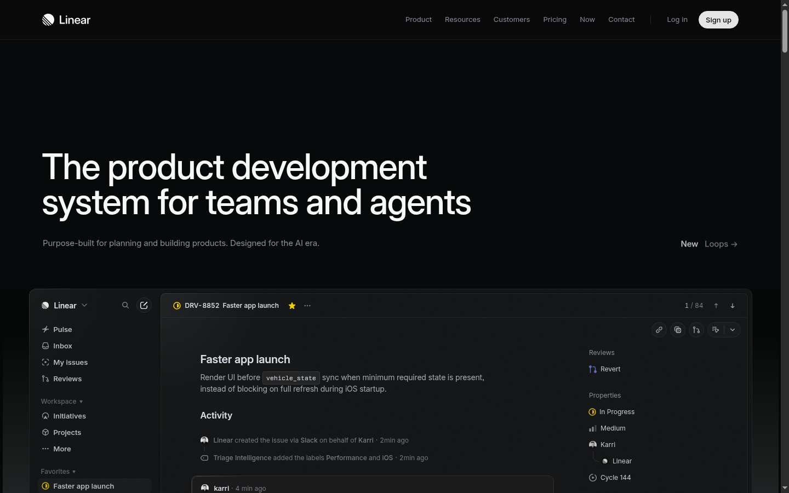 |
| 2 | [Vercel](https://vercel.com/) | Geist, pure black, white type, the product is a dark frame with a single luminous edge. 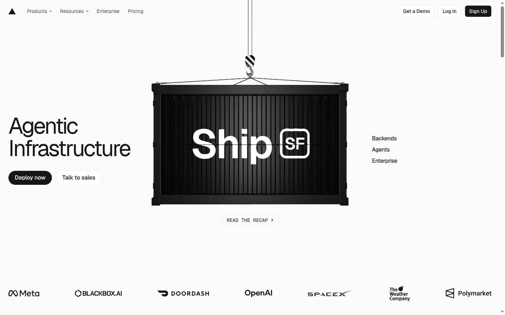 |
| 3 | [Resend](https://resend.com/) | Monochrome, code-sized labels, one green, generous empty space, no stock photography. 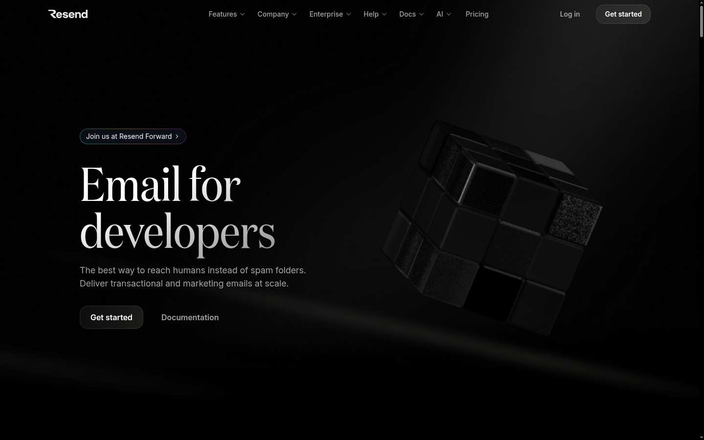 |
| 4 | [Raycast](https://www.raycast.com/) | Dark glass, a shortcut as the product shot, color used as light rather than fill. 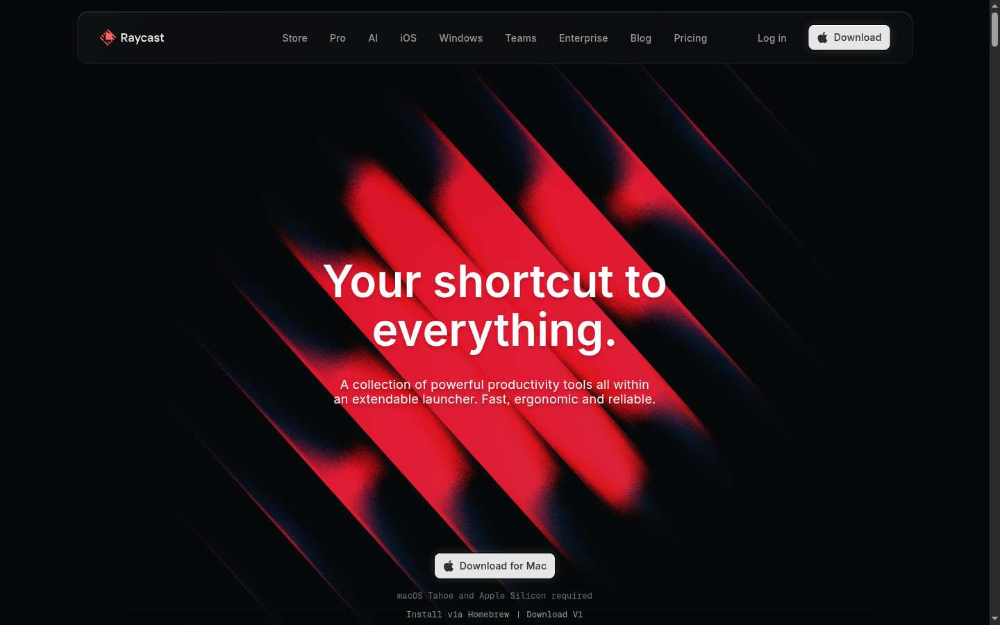 |
| 5 | [Supabase](https://supabase.com/) | Dark canvas, one brand green, technical labels, the product grid is the argument. 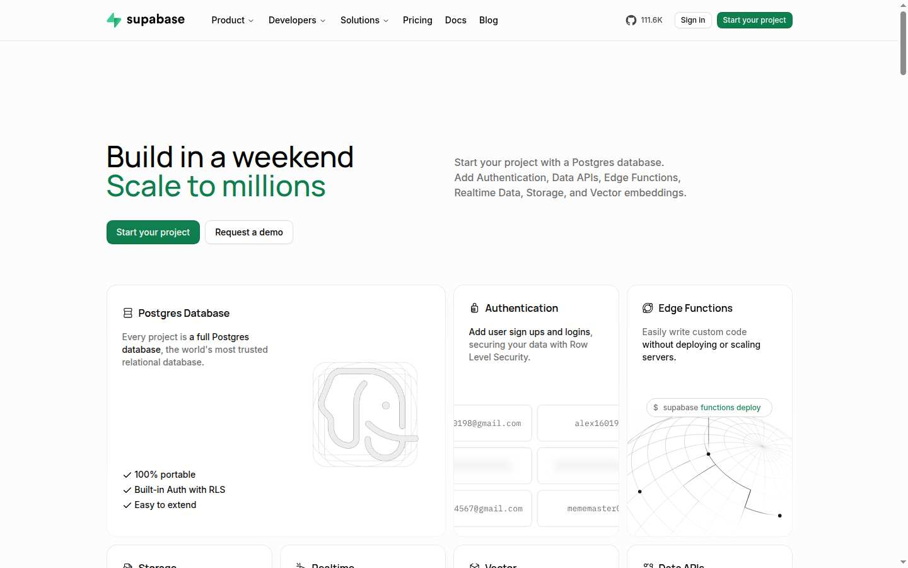 |
| 6 | [Clerk](https://clerk.com/) | Auth treated as a product surface: one card, clear hierarchy, no marketing chrome inside the form. 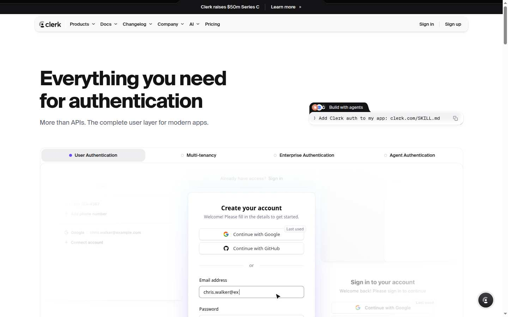 |
| 7 | [Cal.com](https://cal.com/) | Open-source SaaS that still feels finished: tight nav, real UI, restrained color. 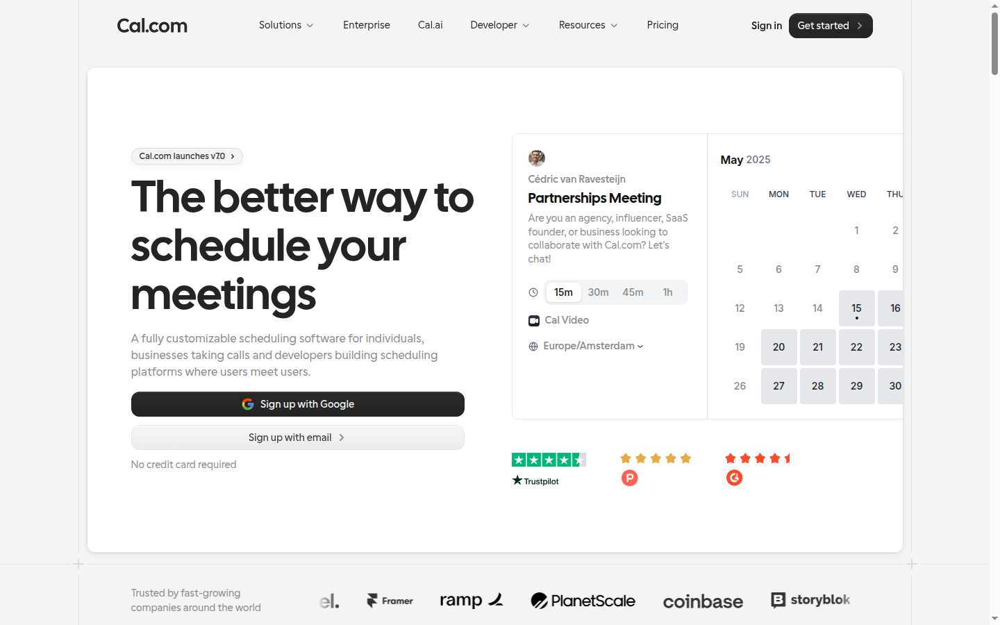 |
| 8 | [Attio](https://attio.com/) | Data density without clutter. Tables and records are the visual, not illustrations of tables. 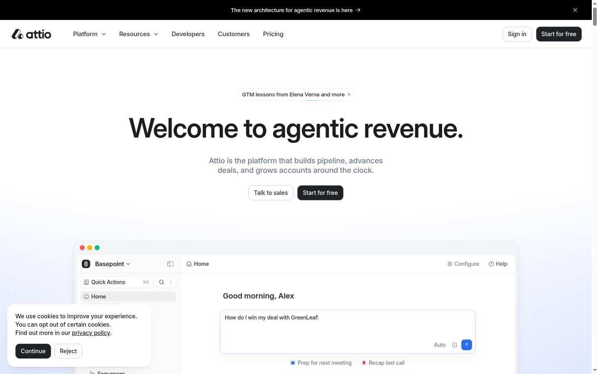 |
| 9 | [Mercury](https://mercury.com/) | Money set in a large grotesque, calm contrast, numbers are the hero. 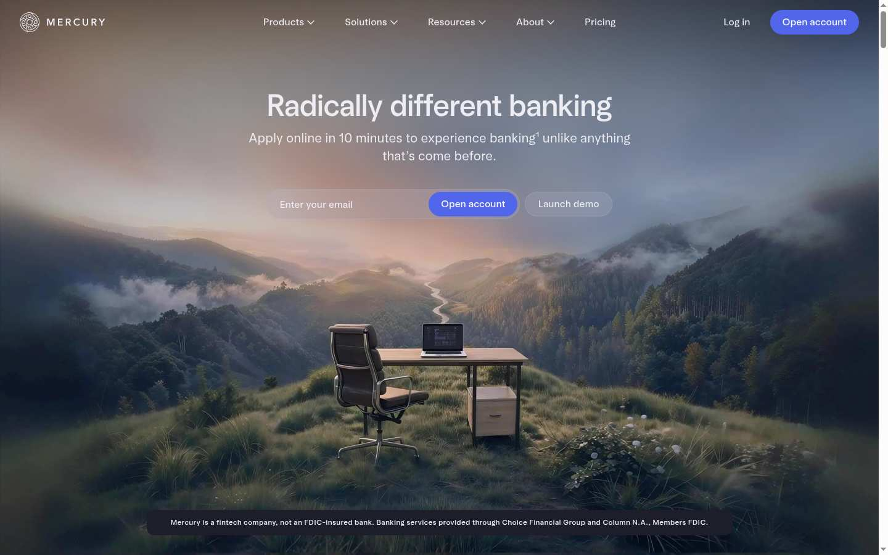 |
| 10 | [Ramp](https://ramp.com/) | Fintech that stays sharp: black, white, one accent, product frames instead of abstract blobs. 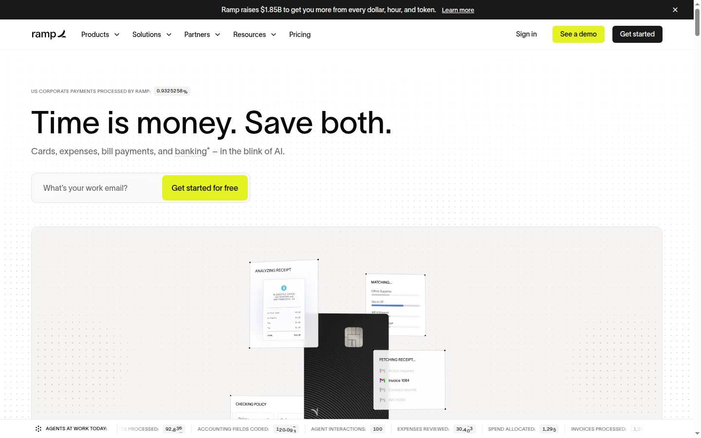 |
| 11 | [Stripe](https://stripe.com/) | Editorial rhythm, long measure, gradients that sit behind type instead of on it. 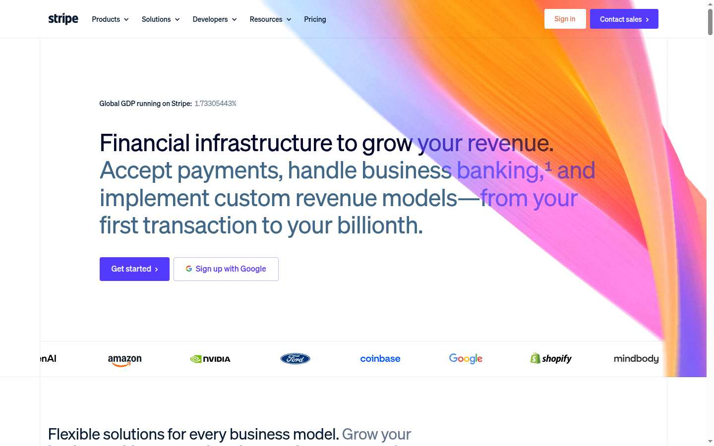 |
| 12 | [Framer](https://www.framer.com/) | Oversized type, motion that is the layout, not a decoration on a static page. 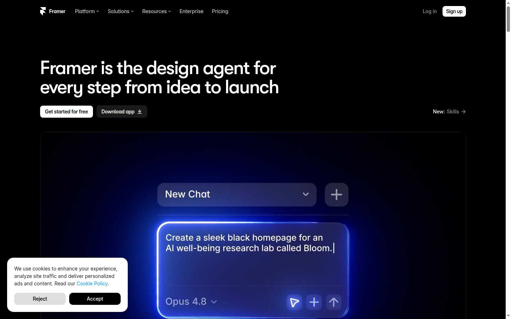 |
| 13 | [Godly](https://godly.website/) | A grid of current marketing sites. The ones that hold up are type-led and show the product. 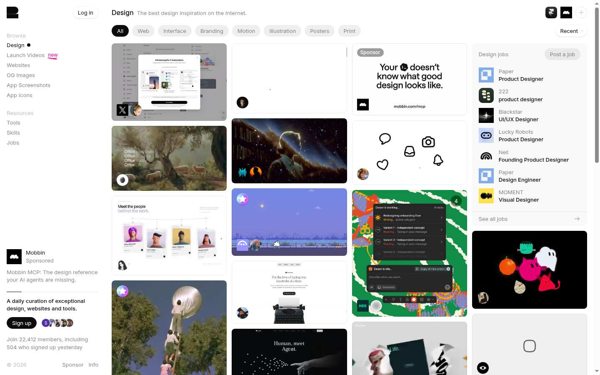 |
| 14 | [Awwwards SOTD](https://www.awwwards.com/websites/sites_of_the_day/) | Recent winners earn the award with pacing and craft, not with a second typeface and a gradient mesh. 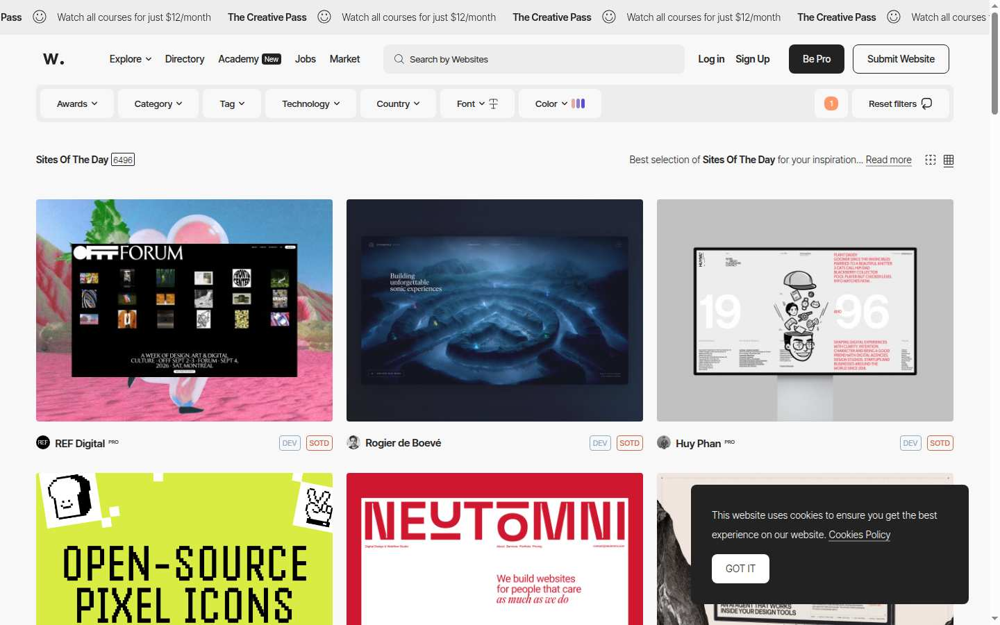 |

## Direction

**Signal.** A dark instrument, not a gray brochure.

Borrowed from Linear and Resend: hairline borders, small radius, mono labels, one accent. Borrowed from Mercury: the number is the headline. The accent is phosphor `#d6ff4a` on near-black, used for the primary action, the score, and focus. Risk stays written: Low, Medium, High.

## Tokens

| Token | Value | Role |
| --- | --- | --- |
| canvas | `#07080a` | Page |
| card | `#121318` | Surfaces |
| raised | `#1a1b20` | Active nav, nested wells |
| line | `#2a2c33` | 1px borders |
| ink | `#f4f4f5` | Text |
| muted | `#9a9aa3` | Secondary |
| accent | `#d6ff4a` | Primary, focus, score |
| low | `#3dd68c` | Low band, with the word |
| mid | `#f5c16c` | Medium band, with the word |
| high | `#ff6b6b` | High band and destructive actions |

Type is **Geist** and **Geist Mono** (Vercel, OFL). Hindi confirmation copy uses **Noto Sans** Devanagari. Display tracking is about `-0.045em`. Labels are 11px mono, uppercase, `0.16–0.22em`.

Radius: 8px controls, 16px cards, 6px status chips. Spacing steps are 4, 8, 12, 16, 24, 32, 48, 80. Icons are Lucide, 15–16px, stroke 1.5.

Elevation is a border plus, on the hero frame only, a soft phosphor glow. Grain is a fixed overlay at low opacity.

## Motion

Lenis on the marketing page (`lerp` 0.1) drives ScrollTrigger. The hero rises in 0.8s. Sections reveal on enter. Example-day figures tick once. Primary controls ease toward the pointer. Buttons scale to 0.98 on press. Charts draw in. Routes fade 0.35s.

`prefers-reduced-motion` skips Lenis, the reveals, the tickers, the marquee, and the chart draw. Focus is a 2px phosphor ring.
