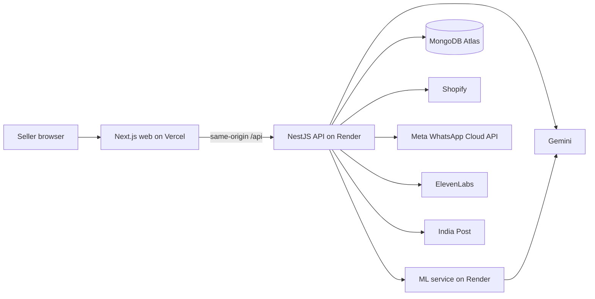
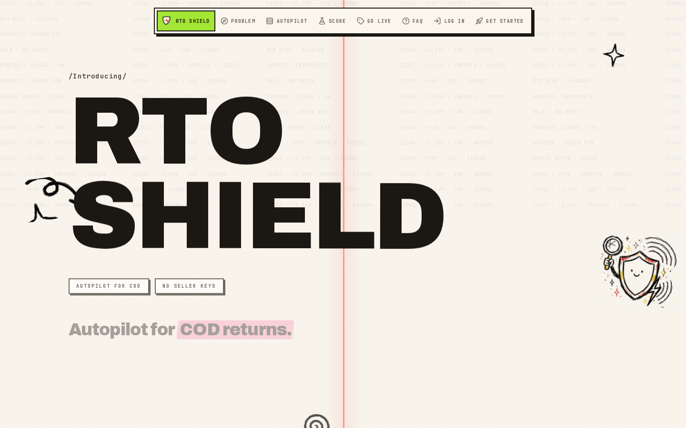
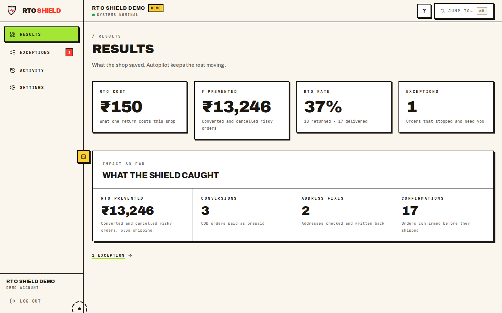
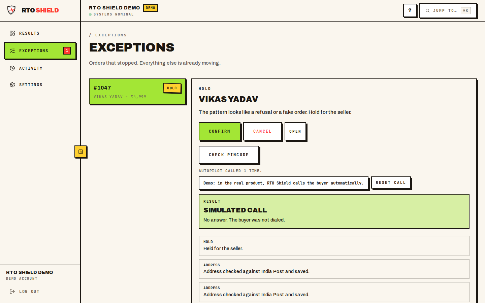
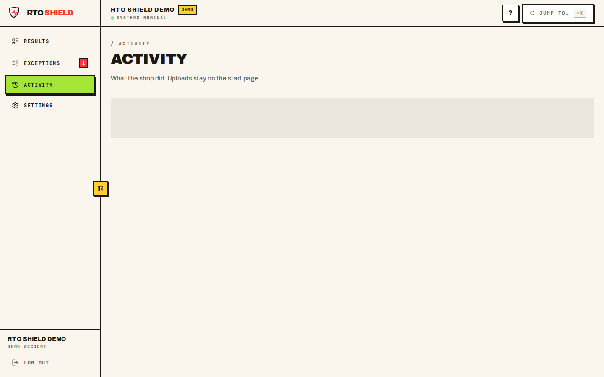
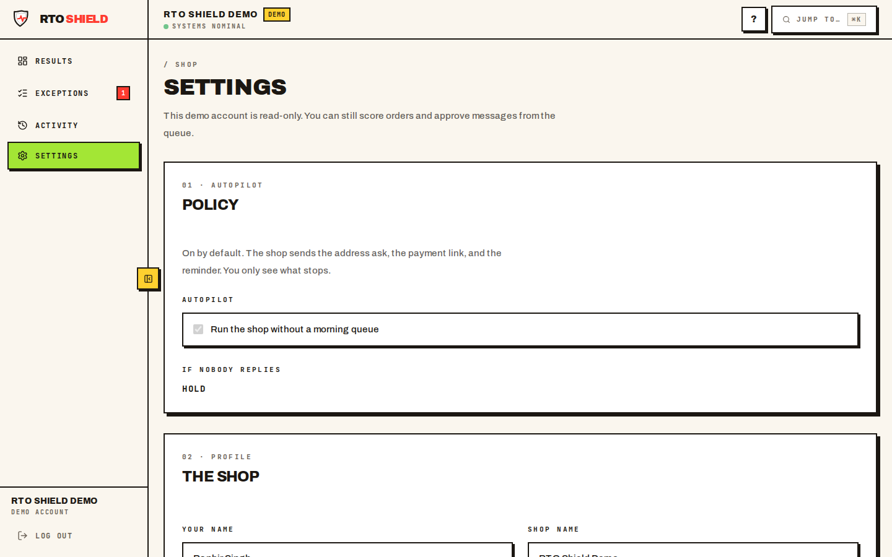
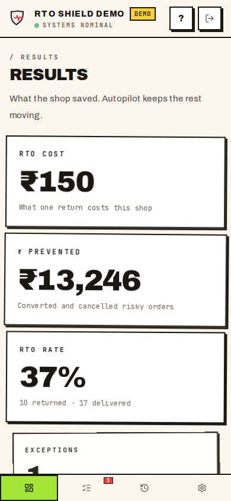

# RTO Shield

Autopilot for cash-on-delivery returns. It scores an order, messages the buyer, fixes the address, and calls when nobody answers. The seller sees what stopped.

Live demo: [www.rtoshield.tech](https://www.rtoshield.tech)

Suggested price: ₹499 a month. This build does not take a card.

## The problem

A refused cash-on-delivery parcel in India still costs the return trip. RTO Shield uses **₹150** as the default cost of the shipping on one return-to-origin. The shop can change that number. Results counts rupees prevented as converted and cancelled risky orders, plus shipping. It is a planning figure, not a payout.

The buyer is asked before the parcel ships. A bad address is checked. A silent buyer gets a call. The orders that still need a person land on Exceptions.

## Features

- **Score.** Each pending order gets 0–100, a Low, Medium, or High band, and a short reason. A pincode is courier context, not a ban.
- **Autopilot WhatsApp.** Messages go out from RTO Shield’s platform number. The template carries the shop’s name and the order. A shop can turn on its own WhatsApp Business number. Sellers do not paste a token.
- **Address fix.** A buyer reply is parsed on the API. India Post (`api.postalpincode.in`) checks the pin. When the city and state agree, the address is written back to Shopify and confirmation continues.
- **AI calls.** Autopilot calls when nobody replies. On Exceptions the seller gets **one extra call**. No answer leaves Confirm and Cancel in place. `CALLS_MODE=browser` records a Simulated call and does not dial. `live` dials when a calling number is set.
- **Demo call.** A judge session can talk to the agent in the browser. Two demo calls per 30 minutes, per demo session and per IP, plus the existing daily cap. **Reset call** on the Exceptions detail starts a fresh one.
- **Screens.** Results, Exceptions, Activity, and Settings.
- **Voice tour.** A robot voice walks the app in Hindi, English, or Hinglish.
- **Platform AI.** Gemini and ElevenLabs are server env vars. Sellers do not paste keys. Missing Gemini falls back to built-in templates.
- **Production switches.** Test mode and live mode are config. See [docs/PRODUCTION.md](docs/PRODUCTION.md).

## Architecture



| Piece | Where | Role |
| --- | --- | --- |
| `apps/web` | Vercel | Next.js 15, TypeScript, Tailwind. Landing, auth, Results, Exceptions, Activity, Settings. Proxies `/api` to the Nest origin. |
| `apps/api` | Render | NestJS. Sessions, orders, Shopify, WhatsApp, calls, address replies, India Post. |
| `apps/ml` | Render | FastAPI. Address notes, confirmation drafts, and the score. TabPFN when configured, otherwise scikit-learn, otherwise a rules prior. |
| MongoDB | Atlas | Orders, users, audit. Dev without `MONGODB_URI` uses an in-memory database. |

The public hosts are [www.rtoshield.tech](https://www.rtoshield.tech), [api.rtoshield.tech](https://api.rtoshield.tech), and [ml.rtoshield.tech](https://ml.rtoshield.tech). The API and ML service on Render’s free plan sleep after about 15 minutes. The site holds their health checks open until both answer `{ ok: true }`.

Phones and street addresses are encrypted at rest. Lists mask the phone. The score does not receive the phone or the buyer’s name.

## Autopilot

1. A new COD order is scored.
2. Autopilot sends the confirmation on WhatsApp from the platform number, with the store name on the template. A shop that turned on its own number uses that number instead.
3. A reply that changes the address is parsed with the platform Gemini key on the API. India Post must agree. A good fix is written to Shopify, then the confirmation continues. A miss falls back to the template path.
4. No reply moves the order to a call. Browser mode writes **Simulated call** and does not dial. Live mode places the call through ElevenLabs.
5. What still needs the seller lands on **Exceptions**. **Try one more call** is allowed once. If the buyer answers, the order leaves Exceptions. If nobody answers, Confirm and Cancel stay.
6. **Results** shows what was saved. **Activity** is the log. **Settings** holds the policy, Shopify, and WhatsApp.

## Screenshots













## Tech stack

- Web: Next.js 15, React 19, TypeScript, Tailwind, TanStack Query
- API: NestJS 10, Mongoose, Zod, JWT httpOnly cookies, CSRF
- ML: FastAPI, scikit-learn, optional TabPFN client, optional Gemma via Gemini or Ollama
- Data: MongoDB Atlas
- Integrations: Shopify Admin GraphQL, Meta WhatsApp Cloud API, ElevenLabs, Gemini, India Post pincode API

## Local setup

Node.js 22 and Python 3.12.

```bash
cp .env.example .env
npm ci
python3 -m pip install -r apps/ml/requirements-dev.txt

npm run dev:api
npm run dev:web
cd apps/ml && python3 -m uvicorn app.main:app --host 0.0.0.0 --port 8000
```

Open http://localhost:3000. API is http://localhost:4000. ML is http://localhost:8000.

```bash
docker compose up --build
```

That starts the web, API, ML, and Mongo. `docker compose --profile ollama up --build` adds a local Gemma.

Without `MONGODB_URI` the API uses an in-memory database and says so. `NODE_ENV=production` refuses to boot without `MONGODB_URI`, `JWT_SECRET`, and `ENCRYPTION_KEY`.

## Environment variables

Names only. Values live in `.env.example` and on the hosts. Do not commit secrets.

**API:** `PORT`, `NODE_ENV`, `MONGODB_URI`, `JWT_SECRET`, `ENCRYPTION_KEY`, `KEY_ENCRYPTION_KEY`, `WEB_ORIGIN`, `ML_SERVICE_URL`, `ML_INTERNAL_TOKEN`, `COOKIE_SAMESITE`, `COOKIE_SECURE`, `JSON_LIMIT`, `SENTRY_DSN`, `SENTRY_TRACES_SAMPLE_RATE`, `RATE_LIMIT_MAX`, `AUTH_RATE_LIMIT_MAX`, `BCRYPT_ROUNDS`, `INBOX_DRAIN_SECRET`, `CALLS_MODE`, `ELEVENLABS_API_KEY`, `ELEVENLABS_AGENT_ID`, `ELEVENLABS_WEBHOOK_SECRET`, `ELEVENLABS_PHONE_NUMBER_ID`, `ELEVENLABS_WEBHOOK_URL`, `ELEVENLABS_VOICE_ID`, `ELEVENLABS_MODEL_ID`, `SERPAPI_KEY`, `SHOPIFY_API_KEY`, `SHOPIFY_API_SECRET`, `SHOPIFY_APP_URL`, `SHOPIFY_SCOPES`, `SHOPIFY_API_VERSION`, `WHATSAPP_VERIFY_TOKEN`, `WHATSAPP_PLATFORM_TOKEN`, `WHATSAPP_PLATFORM_PHONE_NUMBER_ID`, `WHATSAPP_PLATFORM_WABA_ID`, `WHATSAPP_PLATFORM_APP_SECRET`, `META_GRAPH_VERSION`, `GEMINI_API_KEY`, `DEMO_ACCOUNT_EMAIL`, `DEMO_SESSION_MS`, `DEMO_RESET_HOURS`, `DEMO_WHATSAPP_DAILY_CAP`, `DEMO_WHATSAPP_ALLOWLIST`

**Web:** `API_URL`, `NEXT_PUBLIC_SHOPIFY_API_KEY`, `NEXT_PUBLIC_API_HEALTH_URL`, `NEXT_PUBLIC_ML_HEALTH_URL`, `NEXT_PUBLIC_SENTRY_DSN`

**ML:** `ML_CORS_ORIGINS`, `TABPFN_TOKEN`, `TABPFN_MAX_ROWS`, `GEMINI_API_KEY`, `GEMMA_MODEL`, `OLLAMA_BASE_URL`, `OLLAMA_MODEL`, `MIN_TRAIN_ROWS`

`GEMINI_API_KEY` is required on the API for address-reply parsing and on the ML service for notes and drafts. Empty uses templates.

## Test mode and production

[docs/PRODUCTION.md](docs/PRODUCTION.md) is the switch list.

Test mode keeps `CALLS_MODE=browser` and the Meta test number. Live mode sets the paid WhatsApp number, `CALLS_MODE=live`, and `ELEVENLABS_PHONE_NUMBER_ID`. No code change.

## Tests and CI

```bash
npm test
npm run lint
npm run typecheck
npm run build
cd apps/ml && ruff check app tests && pytest
```

GitHub Actions workflow `CI` runs the JavaScript job (lint, typecheck, unit tests, production build, Playwright) and the Python job (ruff, pytest) on every push and pull request. `Model evaluation` runs the synthetic ML eval on Mondays and on demand. Those numbers describe the synthetic set, not a live shop.

Playwright boots an in-memory API and the built Next app. It covers the seller tour, the judge demo tour, Exceptions, and the official-account owner login.

## Limitations

- The Meta test number can message only numbers that are verified on that Meta app.
- `CALLS_MODE=browser` does not dial. Outbound calls, including Try one more call, are labeled Simulated call. A judge can open the in-browser demo call, limited to two per 30 minutes per session and per IP, and still subject to the daily cap.
- Render’s free API and ML instances sleep. The first request after idle can take about a minute.
- A pincode check needs India Post to answer. A miss is recorded on the order and the fix is skipped.

## License

[MIT](LICENSE). Copyright (c) 2026 Ranbir Singh.
