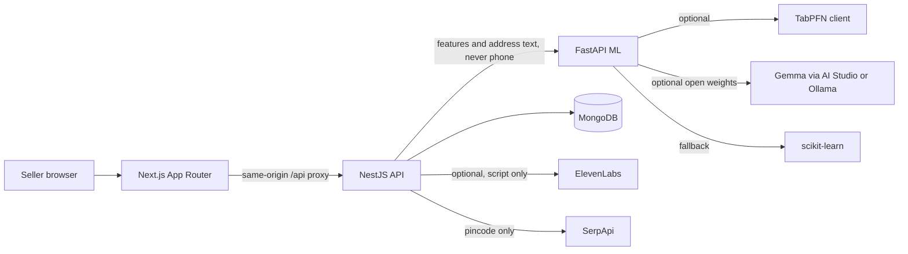

# RTO Shield

Stop paying ₹150 for every cash-on-delivery order that comes back.

RTO Shield is for small Indian sellers on Meesho, Instagram, WhatsApp, and small Shopify stores (about 20–500 orders a day). It scores which COD orders are likely to be refused **before** they ship, then helps you confirm the risky ones with the buyer.

Suggested price: **₹499/month**. This open-source build does not charge a card.

## The problem

A refused COD parcel still costs reverse shipping. This product uses **₹150** as the default cost per return-to-origin (RTO). You can change it. The dashboard estimates rupees saved as: risky orders you cancelled × that cost. That is a planning number, not a payout.

Example, labeled as an example: 40 COD orders a day, 8 come back, ₹150 each → ₹1,200 a day. Preventing a handful covers a ₹499 month.

## Demo

Recordings belong in `docs/demo/` (see that folder). Until you drop them in:


What those should show:

1. Sign up, press **Try with sample data**, then **Score pending orders**.
2. Open a High-risk card, WhatsApp click-to-chat (nothing is auto-sent), play the Hindi script, mark confirmed / cancelled / no response.
3. Dashboard: weekly RTO rate, rupees saved, risk mix, plain-language reasons.

The product runs with **zero API keys**. Sample buyers are synthetic.

## Architecture



| Piece | Role |
| --- | --- |
| `apps/web` | Next.js 15 App Router, TypeScript, Tailwind. Landing, auth, history upload, scoring, queue, settings. |
| `apps/api` | NestJS on the Express adapter. JWT httpOnly cookies, CSRF double-submit, `@nestjs/throttler`, helmet, Zod pipes, Mongoose. |
| `apps/ml` | FastAPI. TabPFN in-context on the seller’s history, then local TabPFN, then scikit-learn, then a rules prior. |
| MongoDB | Atlas in production (`MONGODB_URI`). In-memory Mongo when the URI is unset outside production. |

The browser only talks to Next.js. Next proxies `/api/*` to Nest and forwards `Set-Cookie`, so the session is first-party.

### Scoring

Address quality (incomplete, landmark-only, junk, pincode mismatch) is a **feature**. Gemma produces it when configured. Priority: **Ollama (privacy-max, can be offline) → Gemma on Google AI Studio → local rules**.

TabPFN then scores the numeric features in-context. The UI always names the model that ran, including the scikit-learn fallback when `TABPFN_TOKEN` is missing.

**A pincode is not a model feature and never a ban.** SerpApi, if configured, only adds cached locality / courier-search context. The fairness note is returned by the API.

Phone numbers are not sent to TabPFN, Gemma, SerpApi, or ElevenLabs. The Hindi voice script is shop name and amount only. WhatsApp is a `wa.me` link the seller clicks.

Confirmed orders are treated as accepted (label 0) and cancelled orders as refused (label 1) the next time you score. No-response is excluded.

### Why open-source AI

- **Buyer privacy.** Phone and street address are encrypted at rest (AES-GCM). Lists mask the phone. Ollama keeps address text on a machine you control.
- **No per-call model bill on the default path.** With no keys, scoring is scikit-learn on your own history.
- **Small data.** TabPFN is built to train in-context on hundreds of rows, which is what a 20–500 order/day shop actually has.
- **Offline Gemma.** `OLLAMA_BASE_URL` runs Gemma locally. AI Studio is the hosted open-weight option, not a closed model.

## Model evaluation

Held-out split on the synthetic shop (`apps/ml`, seed 42, 360 labelled orders). No API keys, so this is the scikit-learn fallback. Re-run with `python -m app.eval_sample` from `apps/ml`. GitHub Actions workflow **Model evaluation** does that every Monday and on demand.

| Metric | Result |
| --- | --- |
| Model | scikit-learn gradient boosting |
| AUC | **0.793** |
| Precision in the riskiest 10% | **1.00** |
| Train / test | 288 / 72 |
| COD RTO rate in the generator | 70% |
| Prepaid RTO rate in the generator | 18% |

These numbers describe the synthetic set, which was built so COD, weak addresses, new buyers, and repeat refusers return more often. They are not a claim about a live shop. Each seller’s dashboard shows their own held-out AUC after they score.

## Setup

Requirements: Node.js 22, Python 3.12, and optionally Docker.

```bash
cp .env.example .env
npm ci
python3 -m pip install -r apps/ml/requirements-dev.txt

# three terminals
npm run dev:api
npm run dev:web
cd apps/ml && python3 -m uvicorn app.main:app --host 0.0.0.0 --port 8000
```

Open http://localhost:3000. Create a shop, open History, press **Try with sample data**, then Score.

Without `MONGODB_URI` the API uses an in-memory database and warns you. Without `JWT_SECRET` / `ENCRYPTION_KEY` it uses development secrets and says so. `NODE_ENV=production` refuses to boot without `MONGODB_URI`, `JWT_SECRET`, and `ENCRYPTION_KEY`.

### Docker Compose

```bash
docker compose up --build
```

Web http://localhost:3000, API http://localhost:4000, ML http://localhost:8000, Mongo on 27017.

Privacy-max Gemma:

```bash
docker compose --profile ollama up --build
docker compose exec ollama ollama pull gemma3:4b
```

Then set `OLLAMA_BASE_URL=http://ollama:11434` on the ML service.

### Tests

```bash
npm test          # Jest (API, including in-memory Mongo) and Vitest (web)
npm run lint
npm run typecheck
npm run build
cd apps/ml && ruff check app tests && pytest
```

### CSV columns

Column mapping is a step after upload. Presets:

| Source | Identity columns |
| --- | --- |
| Generic | `order_id`, `buyer_name`, `phone`, `address`, `pincode`, `order_value`, `payment_type`, `outcome` |
| Shopify export | `Name`, `Shipping Name`, `Shipping Address1`, `Shipping Zip`, `Total`, `Payment Method` |
| Meesho-style | `Sub Order No`, `Customer Name`, `Mobile`, `Address`, `Pincode`, `Price`, `Payment Mode`, `Order Status` |

Files: `apps/web/public/samples/`. History rows need a delivered or RTO outcome. Empty payment is treated as COD. Shopify `paid` is prepaid; `pending` is treated as COD. `prior_orders` and `prior_rtos` default to 0. Re-importing the same order id skips the duplicate. **Try with sample data** replaces previous sample rows and leaves real uploads.

Upload cap: 5 MB, 5,000 rows. Export prefixes cells that start with `=`, `+`, `-`, or `@`.

## Deploy on Render

`render.yaml` is a Blueprint with three web services:

1. **rto-shield-ml** — Python, `uvicorn`, health `/health`.
2. **rto-shield-api** — Node, `npm run start -w @rto/api`, health `/api/health`.
3. **rto-shield-web** — Node, `npm run start -w @rto/web`, health `/`.

In the Render dashboard: New → Blueprint → this repo.

After the first create:

1. Set **MONGODB_URI** on the API to a MongoDB Atlas connection string.
2. Set **WEB_ORIGIN** on the API to the web service origin, for example `https://rto-shield-web.onrender.com`.
3. `API_URL` on the web service and `ML_SERVICE_URL` on the API are wired with `fromService`. Confirm they point at the public `https://` URLs.
4. Optional keys (`TABPFN_TOKEN`, `GEMINI_API_KEY`, `OLLAMA_BASE_URL`, `ELEVENLABS_API_KEY`, `SERPAPI_KEY`, `SENTRY_DSN`) can stay empty. The shop still scores.
5. `JWT_SECRET`, `ENCRYPTION_KEY`, and `ML_INTERNAL_TOKEN` are generated by the Blueprint. Keep them.

Free instances sleep. The first request after idle is slow. Atlas network access must allow Render.

## Environment variables

See `.env.example`. Every integration degrades when its key is missing.

| Variable | Used by | Required |
| --- | --- | --- |
| `MONGODB_URI` | API | Production only. Dev falls back to in-memory Mongo. |
| `JWT_SECRET` | API | Production only. Dev uses a warning secret. |
| `ENCRYPTION_KEY` | API | Production only. 64 hex chars, 32-byte base64, or any passphrase (scrypt). Dev uses a warning key. |
| `WEB_ORIGIN` | API | CORS. Default `http://localhost:3000`. Comma-separated if needed. |
| `ML_SERVICE_URL` | API | Default `http://127.0.0.1:8000`. |
| `ML_INTERNAL_TOKEN` | API and ML | Optional shared secret. If set on ML, predict/messages require the header. |
| `COOKIE_SAMESITE` | API | `lax` (default), `strict`, or `none`. |
| `COOKIE_SECURE` | API | `true` in production behind HTTPS. |
| `SENTRY_DSN` | API, web, ML | Optional. Spans record latency and token counts for Gemma and TabPFN. PII is stripped. |
| `SENTRY_TRACES_SAMPLE_RATE` | API, web, ML | Default `0.2`. |
| `ELEVENLABS_API_KEY` | API | Optional Hindi audio. Without it, the script is text only. |
| `ELEVENLABS_VOICE_ID` | API | Optional. Default multilingual voice. |
| `ELEVENLABS_MODEL_ID` | API | Default `eleven_multilingual_v2`. |
| `SERPAPI_KEY` | API | Optional pincode search. Without it, embedded localities and PIN-prefix regions. |
| `RATE_LIMIT_MAX` | API | Default 300 / minute. |
| `AUTH_RATE_LIMIT_MAX` | API | Default 30 / 15 minutes on auth routes. |
| `BCRYPT_ROUNDS` | API | Default 12. |
| `API_URL` | Web server | Nest origin for the proxy. Not exposed to the browser. |
| `NEXT_PUBLIC_SENTRY_DSN` | Web | Optional browser Sentry. |
| `TABPFN_TOKEN` | ML | Optional Prior Labs TabPFN. |
| `TABPFN_MAX_ROWS` | ML | Default 500 in-context rows. |
| `GEMINI_API_KEY` | ML | Optional Gemma via AI Studio. |
| `GEMMA_MODEL` | ML | Default `gemma-3-27b-it`. |
| `OLLAMA_BASE_URL` | ML | Optional. If set, preferred over AI Studio. |
| `OLLAMA_MODEL` | ML | Default `gemma3:4b`. |
| `MIN_TRAIN_ROWS` | ML | Default 30 labelled rows before a trained model. Below that, a rules prior. |
| `PORT` | API and web | Render sets this. Local defaults 4000 and 3000. |

## Security notes

- Passwords: bcrypt. Access JWT 15 minutes, refresh 7 days, both httpOnly. Logout bumps a token version.
- CSRF: cookie compared to `x-csrf-token` with a timing-safe check on every mutating request.
- Seller id is part of every order query. A missing order is a 404 for other sellers too.
- Settings can export or delete orders, or delete the account (password required).
- Rate limits are in-memory. More than one API instance needs a shared store; this build is one instance.

## Credits

- [TabPFN](https://github.com/PriorLabs/TabPFN) by Prior Labs (Hollmann et al.) — in-context tabular model. Optional client or local package.
- [Gemma](https://ai.google.dev/gemma) by Google — open-weight address notes and confirmation drafts, via AI Studio or Ollama.
- scikit-learn gradient boosting — deterministic fallback when TabPFN is not configured.
- NestJS, Next.js, FastAPI, MongoDB, Tailwind, Sentry, and the optional ElevenLabs and SerpApi clients.
- PIN-prefix regions and the embedded locality list are public postal geography, written for this repo. They are context, not a risk score.

MIT License. Copyright (c) 2026 Ranbir Singh.

## Still missing

- No card checkout. ₹499/month is the suggested price, not a billed plan.
- Demo GIFs are placeholders in `docs/demo/`.
- TabPFN (API or local weights) is not installed in the default image. The running model is scikit-learn until you add `TABPFN_TOKEN` or the `tabpfn` package (`apps/ml/requirements-optional.txt`). Local TabPFN pulls PyTorch and is large.
- Rate limiting and sessions are single-process.
- Render free/starter spin-down and Atlas IP access are operator steps, not automated here.
